# CRM Analytics data flow

What this layer tests: each value is followed from where it is defined to everywhere it is used, so one that gets lost, altered or leaked fails a test.

- `dataflow-graph.json` is the machine-readable graph: 361 nodes, 531 edges, each edge with its id, the field defined at the source, and its use.
- Every edge has a test named with its id. `tests/graph-coverage.cjs` fails if one has none, if a test names an unknown edge, or if a stored column, payload field or CTE has no node.
- Run it: `node packages/twenty-utils/flolabs/analytics-tests/run-tests.mjs --layer dataflow`. Local Postgres only, on a database of its own for each run, dropped at the end.

This file is generated from the graph by `lib/render-dataflow-doc.cjs`, and the coverage test fails when it is out of date. To regenerate: `node packages/twenty-utils/flolabs/analytics-tests/dataflow/lib/render-dataflow-doc.cjs --write`.

## Other tests here

| Prefix | What it proves |
|---|---|
| `FP-` | Forward propagation. One input changes; the whole difference across every sink is stated, so anything else that moves fails |
| `TAINT-` | Sentinels in names, emails, phones and form answers reach no analytics column and no payload, except the stuck list's live display name |
| `UNIT-` | `happened_at` stays a UTC instant, local dates only make buckets, rates stay fractions until the UI, counts stay integers |
| `UNKNOWN-` | An unmapped stage reaches the Unmapped row, never a funnel step. Too-recent people reach inWindow, never a failure count |
| `FILTER-` | A filter reaches every view of a tab, stored counts included. A bad value stops before any SQL |
| `PATH-` | Real payloads from Postgres rendered by the real components: a value followed from a CRM row to the text on the screen |
| `COVERAGE-` | The graph, the tests and the code have not drifted apart |

## Graph

Columns are folded into tables, and CTEs, metrics and payload fields into families, so it can be read. The JSON has each one.

```mermaid
flowchart LR
  subgraph group_crm["CRM tables"]
    core_keyValuePair["core.keyValuePair"]
    crm_application_rows["application.rows"]
    crm_crmForm_name["crmForm.name"]
    crm_formSubmission_deletedAt["formSubmission.deletedAt"]
    crm_formSubmission_personId["formSubmission.personId"]
    crm_formSubmission_submittedAt["formSubmission.submittedAt"]
    crm_metadata_objects["metadata.objects"]
    crm_metadata_person_applicantSource["metadata.person.applicantSource"]
    crm_metadata_person_positionsAppliedFor["metadata.person.positionsAppliedFor"]
    crm_metadata_person_stage["metadata.person.stage"]
    crm_person_applicantSource["person.applicantSource"]
    crm_person_createdAt["person.createdAt"]
    crm_person_deletedAt["person.deletedAt"]
    crm_person_id["person.id"]
    crm_person_name["person.name"]
    crm_person_positionsAppliedFor["person.positionsAppliedFor"]
    crm_person_stage["person.stage"]
    crm_person_updatedAt["person.updatedAt"]
    crm_timelineActivity_happensAt["timelineActivity.happensAt"]
    crm_timelineActivity_id["timelineActivity.id"]
    crm_timelineActivity_linkedRecordId["timelineActivity.linkedRecordId"]
    crm_timelineActivity_properties_diff_stage["timelineActivity.properties.diff.stage"]
    crm_timelineActivity_targetPersonId["timelineActivity.targetPersonId"]
    crm_timelineActivity_updatedAt["timelineActivity.updatedAt"]
  end
  subgraph group_facade["Facade relations"]
    facade_crmState["crmState"]
    facade_displayNames["displayNames"]
    facade_importedApplications["importedApplications"]
    facade_personRelation["personRelation"]
    facade_stageChangeRelation["stageChangeRelation"]
    facade_submissionRelation["submissionRelation"]
  end
  subgraph group_mapping_and_settings["Mapping constant and settings"]
    config_other["other config values"]
    config_stages["CRM_ANALYTICS_CONFIG.stages"]
    config_tracks["CRM_ANALYTICS_CONFIG.tracks"]
    settings_isDisabled["isDisabled"]
    settings_trackingStart["trackingStart"]
  end
  subgraph group_job["Sync, reconcile, snapshot and report jobs"]
    job["sync and daily jobs"]
    report_builder["report builder and periods"]
    sync_cursor["cursor"]
    sync_readTimeline["readTimeline"]
    sync_reconcile["reconcile"]
    sync_snapshot["snapshot"]
  end
  subgraph group_storage["Analytics tables"]
    analytics_daily_snapshot["analytics.daily_snapshot"]
    analytics_report["analytics.report"]
    analytics_stage_transition["analytics.stage_transition"]
    analytics_sync_log["analytics.sync_log"]
  end
  subgraph group_api_input["Filter and query arguments"]
    api_input["filter and query arguments"]
  end
  subgraph group_cte["CTEs"]
    cte_base_CTEs["crm_person, scope, transition, first_move, cohort, arrival, person_step, mapped_mover"]
    cte_category_CTEs["person_position, category_member"]
    cte_funnel_CTEs["funnel_group, step_row, step_exit, step_total, overall_row, overall_total"]
    cte_mapping_CTEs["stage_map, position_map, funnel_stage"]
    cte_movement_CTEs["period_move, entered_total, left_total, current_total"]
    cte_snapshot_CTEs["snapshot_day, bucket_day, matching_row"]
    cte_stage_clock_CTEs["latest_entry, moved_person, stage_clock, stage_age"]
    cte_stay_CTEs["stay_event, ordered_event, kept_event, stay, completed_stay"]
    cte_submission_CTE["submission"]
  end
  subgraph group_metric["Metrics"]
    metric_category_rows["category rows"]
    metric_cohort_table["cohort table"]
    metric_current_state["current state"]
    metric_funnel_step["funnel step"]
    metric_movement_and_comparisons["movement and comparisons"]
    metric_new_applications["new applications"]
    metric_overall_conversion["overall conversion"]
    metric_stage_duration["stage duration"]
    metric_sync_and_page_state["sync and page state"]
    metric_trend_lines["trend lines"]
  end
  subgraph group_payload["GraphQL payload"]
    payload_base["base"]
    payload_categories["categories"]
    payload_categories_rows["categories.rows"]
    payload_funnel["funnel"]
    payload_funnel_overall["funnel.overall"]
    payload_funnel_rows["funnel.rows"]
    payload_meta["meta"]
    payload_meta_fields["meta.fields"]
    payload_meta_programs["meta.programs"]
    payload_meta_sources["meta.sources"]
    payload_meta_stages["meta.stages"]
    payload_meta_sync["meta.sync"]
    payload_meta_tracks["meta.tracks"]
    payload_overview["overview"]
    payload_overview_figures["overview.figures"]
    payload_overview_stageTotals["overview.stageTotals"]
    payload_overview_stuck["overview.stuck"]
    payload_report["report"]
    payload_reports["reports"]
    payload_trends["trends"]
    payload_trends_cohorts["trends.cohorts"]
    payload_trends_movement["trends.movement"]
    payload_trends_series["trends.series"]
  end
  subgraph group_ui["UI components"]
    ui_AnalyticsCategoryTable["AnalyticsCategoryTable"]
    ui_AnalyticsCohortTable["AnalyticsCohortTable"]
    ui_AnalyticsContent["AnalyticsContent"]
    ui_AnalyticsFiguresRow["AnalyticsFiguresRow"]
    ui_AnalyticsFilterBar["AnalyticsFilterBar"]
    ui_AnalyticsMovementTable["AnalyticsMovementTable"]
    ui_AnalyticsOverviewTab["AnalyticsOverviewTab"]
    ui_AnalyticsReportView["AnalyticsReportView"]
    ui_AnalyticsReportsTab["AnalyticsReportsTab"]
    ui_AnalyticsStageLedger["AnalyticsStageLedger"]
    ui_AnalyticsStageTotalsTable["AnalyticsStageTotalsTable"]
    ui_AnalyticsStuckTable["AnalyticsStuckTable"]
    ui_AnalyticsSyncLine["AnalyticsSyncLine"]
    ui_AnalyticsTrendChart["AnalyticsTrendChart"]
    ui_AnalyticsTrendTable["AnalyticsTrendTable"]
    ui_buildTrendChartSeries["buildTrendChartSeries"]
  end
  analytics_daily_snapshot --> analytics_sync_log
  analytics_daily_snapshot --> cte_snapshot_CTEs
  analytics_report --> payload_report
  analytics_report --> payload_reports
  analytics_report --> report_builder
  analytics_stage_transition --> cte_base_CTEs
  analytics_stage_transition --> sync_cursor
  analytics_stage_transition --> sync_readTimeline
  analytics_stage_transition --> sync_reconcile
  analytics_sync_log --> metric_sync_and_page_state
  api_input --> cte_base_CTEs
  api_input --> cte_snapshot_CTEs
  api_input --> metric_movement_and_comparisons
  api_input --> metric_new_applications
  api_input --> metric_trend_lines
  api_input --> payload_categories
  api_input --> payload_trends
  config_other --> analytics_daily_snapshot
  config_other --> cte_funnel_CTEs
  config_other --> facade_submissionRelation
  config_other --> metric_current_state
  config_other --> metric_funnel_step
  config_other --> metric_movement_and_comparisons
  config_other --> metric_sync_and_page_state
  config_other --> metric_trend_lines
  config_other --> payload_base
  config_other --> payload_funnel_overall
  config_other --> payload_meta
  config_other --> report_builder
  config_other --> settings_trackingStart
  config_stages --> cte_mapping_CTEs
  config_stages --> metric_current_state
  config_stages --> payload_categories
  config_stages --> payload_funnel_overall
  config_stages --> payload_funnel_rows
  config_stages --> payload_meta_stages
  config_tracks --> cte_mapping_CTEs
  config_tracks --> metric_category_rows
  config_tracks --> payload_meta_programs
  config_tracks --> payload_meta_tracks
  core_keyValuePair --> settings_isDisabled
  core_keyValuePair --> settings_trackingStart
  crm_application_rows --> facade_importedApplications
  crm_crmForm_name --> facade_submissionRelation
  crm_formSubmission_deletedAt --> facade_submissionRelation
  crm_formSubmission_personId --> facade_submissionRelation
  crm_formSubmission_submittedAt --> facade_submissionRelation
  crm_metadata_objects --> facade_crmState
  crm_metadata_person_applicantSource --> facade_crmState
  crm_metadata_person_positionsAppliedFor --> facade_crmState
  crm_metadata_person_stage --> facade_crmState
  crm_person_applicantSource --> facade_personRelation
  crm_person_createdAt --> facade_personRelation
  crm_person_deletedAt --> facade_personRelation
  crm_person_deletedAt --> facade_submissionRelation
  crm_person_id --> facade_personRelation
  crm_person_name --> facade_displayNames
  crm_person_positionsAppliedFor --> facade_personRelation
  crm_person_stage --> facade_personRelation
  crm_person_updatedAt --> facade_personRelation
  crm_timelineActivity_happensAt --> facade_stageChangeRelation
  crm_timelineActivity_id --> facade_stageChangeRelation
  crm_timelineActivity_linkedRecordId --> facade_stageChangeRelation
  crm_timelineActivity_properties_diff_stage --> facade_stageChangeRelation
  crm_timelineActivity_targetPersonId --> facade_stageChangeRelation
  crm_timelineActivity_updatedAt --> facade_stageChangeRelation
  cte_base_CTEs --> cte_category_CTEs
  cte_base_CTEs --> cte_funnel_CTEs
  cte_base_CTEs --> cte_movement_CTEs
  cte_base_CTEs --> cte_stage_clock_CTEs
  cte_base_CTEs --> cte_stay_CTEs
  cte_base_CTEs --> metric_category_rows
  cte_base_CTEs --> metric_current_state
  cte_base_CTEs --> metric_funnel_step
  cte_base_CTEs --> metric_new_applications
  cte_base_CTEs --> metric_trend_lines
  cte_category_CTEs --> cte_funnel_CTEs
  cte_category_CTEs --> metric_category_rows
  cte_funnel_CTEs --> metric_category_rows
  cte_funnel_CTEs --> metric_cohort_table
  cte_funnel_CTEs --> metric_funnel_step
  cte_funnel_CTEs --> metric_overall_conversion
  cte_funnel_CTEs --> metric_trend_lines
  cte_mapping_CTEs --> analytics_daily_snapshot
  cte_mapping_CTEs --> cte_base_CTEs
  cte_mapping_CTEs --> cte_category_CTEs
  cte_mapping_CTEs --> cte_stage_clock_CTEs
  cte_mapping_CTEs --> sync_reconcile
  cte_movement_CTEs --> metric_movement_and_comparisons
  cte_snapshot_CTEs --> metric_trend_lines
  cte_stage_clock_CTEs --> metric_current_state
  cte_stay_CTEs --> metric_stage_duration
  cte_stay_CTEs --> metric_trend_lines
  cte_submission_CTE --> metric_category_rows
  cte_submission_CTE --> metric_new_applications
  cte_submission_CTE --> metric_trend_lines
  facade_crmState --> metric_category_rows
  facade_crmState --> metric_current_state
  facade_crmState --> metric_sync_and_page_state
  facade_crmState --> payload_meta_fields
  facade_crmState --> payload_meta_programs
  facade_crmState --> payload_meta_sources
  facade_displayNames --> metric_current_state
  facade_importedApplications --> metric_current_state
  facade_personRelation --> analytics_daily_snapshot
  facade_personRelation --> analytics_sync_log
  facade_personRelation --> cte_base_CTEs
  facade_personRelation --> sync_reconcile
  facade_stageChangeRelation --> analytics_stage_transition
  facade_submissionRelation --> cte_submission_CTE
  job --> analytics_daily_snapshot
  job --> analytics_report
  job --> analytics_stage_transition
  job --> analytics_sync_log
  metric_category_rows --> payload_categories
  metric_category_rows --> payload_categories_rows
  metric_category_rows --> report_builder
  metric_cohort_table --> payload_trends_cohorts
  metric_cohort_table --> report_builder
  metric_current_state --> payload_overview
  metric_current_state --> payload_overview_figures
  metric_current_state --> payload_overview_stageTotals
  metric_current_state --> payload_overview_stuck
  metric_current_state --> report_builder
  metric_funnel_step --> payload_funnel
  metric_funnel_step --> payload_funnel_rows
  metric_funnel_step --> report_builder
  metric_movement_and_comparisons --> payload_trends_movement
  metric_movement_and_comparisons --> report_builder
  metric_new_applications --> metric_movement_and_comparisons
  metric_new_applications --> payload_overview_figures
  metric_new_applications --> report_builder
  metric_overall_conversion --> payload_funnel_overall
  metric_stage_duration --> payload_funnel_rows
  metric_sync_and_page_state --> payload_base
  metric_sync_and_page_state --> payload_meta
  metric_sync_and_page_state --> payload_meta_sync
  metric_sync_and_page_state --> payload_report
  metric_sync_and_page_state --> report_builder
  metric_trend_lines --> metric_cohort_table
  metric_trend_lines --> payload_trends
  metric_trend_lines --> payload_trends_series
  payload_categories --> ui_AnalyticsCategoryTable
  payload_categories_rows --> ui_AnalyticsCategoryTable
  payload_funnel --> ui_AnalyticsStageLedger
  payload_funnel_overall --> ui_AnalyticsStageLedger
  payload_funnel_rows --> ui_AnalyticsStageLedger
  payload_meta --> ui_AnalyticsContent
  payload_meta_fields --> ui_AnalyticsContent
  payload_meta_fields --> ui_AnalyticsFilterBar
  payload_meta_programs --> ui_AnalyticsFilterBar
  payload_meta_sources --> ui_AnalyticsFilterBar
  payload_meta_stages --> ui_AnalyticsCohortTable
  payload_meta_sync --> ui_AnalyticsContent
  payload_meta_sync --> ui_AnalyticsSyncLine
  payload_meta_tracks --> ui_AnalyticsFilterBar
  payload_overview --> ui_AnalyticsOverviewTab
  payload_overview_figures --> ui_AnalyticsFiguresRow
  payload_overview_stageTotals --> ui_AnalyticsStageTotalsTable
  payload_overview_stuck --> ui_AnalyticsStuckTable
  payload_report --> ui_AnalyticsReportView
  payload_reports --> ui_AnalyticsReportsTab
  payload_trends --> ui_AnalyticsTrendChart
  payload_trends_cohorts --> ui_AnalyticsCohortTable
  payload_trends_movement --> ui_AnalyticsMovementTable
  payload_trends_series --> ui_AnalyticsTrendTable
  payload_trends_series --> ui_buildTrendChartSeries
  report_builder --> analytics_report
  report_builder --> payload_report
  settings_isDisabled --> metric_sync_and_page_state
  settings_trackingStart --> cte_base_CTEs
  settings_trackingStart --> facade_stageChangeRelation
  settings_trackingStart --> metric_trend_lines
  settings_trackingStart --> payload_base
  settings_trackingStart --> report_builder
  settings_trackingStart --> sync_cursor
  sync_cursor --> facade_stageChangeRelation
  sync_readTimeline --> analytics_stage_transition
  sync_readTimeline --> analytics_sync_log
  sync_reconcile --> analytics_stage_transition
  sync_reconcile --> analytics_sync_log
  sync_snapshot --> analytics_daily_snapshot
  ui_AnalyticsFilterBar --> api_input
```

## Edges

| From | To | Edges | First id | Example |
|---|---|---:|---|---|
| CRM tables | Facade relations | 26 | DF-001 | `person.id`: person relation identity |
| Mapping constant and settings | Facade relations | 2 | DF-021 | `applicationFormNames`: names compared with crmForm.name |
| CRM tables | Mapping constant and settings | 2 | DF-027 | `value`: override of the tracking start |
| Mapping constant and settings | Mapping constant and settings | 1 | DF-028 | `trackingStartAt`: default tracking start |
| Facade relations | Analytics tables | 12 | DF-030 | `id`: unique source version key |
| Sync, reconcile, snapshot and report jobs | Analytics tables | 26 | DF-037 | `to_stage of the last stored version`: merged row: from the last stored stage |
| Analytics tables | Sync, reconcile, snapshot and report jobs | 5 | DF-038 | `to_stage`: latest version per source row |
| Sync, reconcile, snapshot and report jobs | Facade relations | 1 | DF-043 | `updatedSince`: updatedAt filter of the sync job |
| Mapping constant and settings | Sync, reconcile, snapshot and report jobs | 3 | DF-044 | `trackingStart`: lower bound when nothing is stored yet |
| Facade relations | Sync, reconcile, snapshot and report jobs | 2 | DF-046 | `raw_stage`: current stage compared with the last stored stage |
| CTEs | Sync, reconcile, snapshot and report jobs | 1 | DF-049 | `stage_key`: compared after mapping, so an alias is no move |
| CTEs | Analytics tables | 1 | DF-058 | `track_key`: track rows: track key, UNMAPPED or NONE |
| Mapping constant and settings | Analytics tables | 1 | DF-062 | `reportingTimeZone`: local date of the first run; a rerun adds nothing |
| Analytics tables | Analytics tables | 1 | DF-064 | `all_total, source_total`: consistency check against live_total |
| Mapping constant and settings | CTEs | 6 | DF-075 | `rawValues, stageKey, rank, kind, limitDays`: one row per raw value |
| Facade relations | CTEs | 7 | DF-078 | `person_id`: embedded relation |
| CTEs | CTEs | 46 | DF-083 | `raw_stage, positions, source, created_at`: people in view after filters |
| Filter and query arguments | CTEs | 10 | DF-085 | `status`: ACTIVE, SUCCESS, EXITED, UNMAPPED, NO_STAGE |
| Analytics tables | CTEs | 12 | DF-090 | `person_id`: joined to the cohort and scope |
| CTEs | Metrics | 46 | DF-151 | `raw_stage`: sum over stages |
| Mapping constant and settings | Metrics | 12 | DF-153 | `kind, isSuccess`: decides which stages are active |
| Filter and query arguments | Metrics | 4 | DF-157 | `dateFrom, dateTo`: range, or the last 7 local days |
| Facade relations | Metrics | 6 | DF-159 | `total`: null without the object |
| Metrics | Metrics | 27 | DF-174 | `eligible`: eligible minus reachedNext minus exited |
| Analytics tables | Metrics | 6 | DF-240 | `finished_at`: last success and last reconciliation |
| Sync, reconcile, snapshot and report jobs | Sync, reconcile, snapshot and report jobs | 1 | DF-260 | `periodStart, periodEnd`: range of movement and new applications |
| Metrics | Sync, reconcile, snapshot and report jobs | 8 | DF-261 | `current, previous`: submittedAt inside the period |
| Analytics tables | GraphQL payload | 17 | DF-268 | `period_type`: list item |
| Metrics | GraphQL payload | 97 | DF-273 | `asOf`: GraphQL payload base.asOf |
| Mapping constant and settings | GraphQL payload | 22 | DF-274 | `trackingStartedAt`: GraphQL payload base.trackingStartedAt |
| Facade relations | GraphQL payload | 9 | DF-286 | `stage`: GraphQL payload meta.fields.stage |
| Filter and query arguments | GraphQL payload | 4 | DF-358 | `groupBy`: GraphQL payload categories.groupBy |
| Sync, reconcile, snapshot and report jobs | GraphQL payload | 3 | DF-404 | `periodType`: GraphQL payload report.periodType |
| GraphQL payload | UI components | 98 | DF-421 | `totalContacts`: figure tile shows totalContacts |
| UI components | Filter and query arguments | 6 | DF-519 | `filter.status`: query variable |
