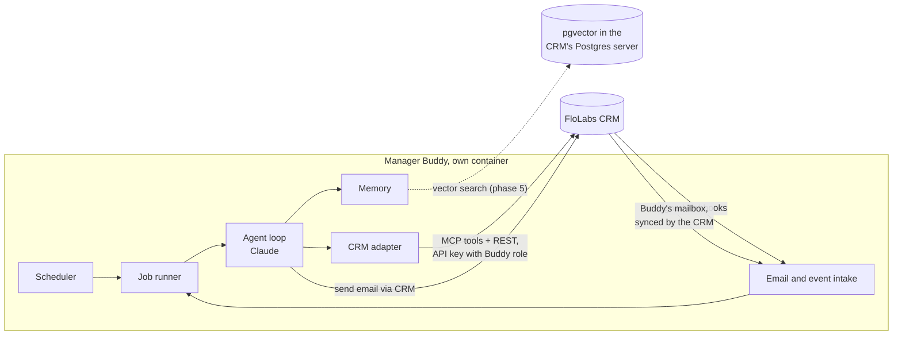

# Manager Buddy

An AI manager for the FloLabs recruiting team. You can assign it tasks, ask it questions, and get updates from it by email. It watches the pipeline on a schedule, follows up on its own, and asks a person before anything that affects an applicant.

**Status:** proposal, not built yet. 28 Oct 2026. Supersedes the in-CRM design in `crm-manager-agent-plan.md`: Buddy is now an independent service that only talks to the CRM through its APIs.

## What it does

| You want to | How it works with Buddy |
|---|---|
| Hand off work | Create a task in the CRM's **Buddy Tasks** list ("chase everyone in Contacted who hasn't sent the form"). Buddy picks it up, works on it, and reports back. |
| Have something followed up | Every task has a "check again on" date. Buddy comes back to it without anyone asking. |
| Ask a question | Email Buddy ("how many people booked a Saturday meeting this week?"). It answers with numbers read from the CRM at that moment. |
| Stay informed | A morning briefing, a weekly report, and an email when something needs a decision. |
| Keep the pipeline moving | Recurring jobs: reply triage, people stuck in a stage, form follow-through, agreements, data clean-up. |

## What it never does

- Decide an applicant's outcome. It never sets Rejected by us, Not Interested or a Signed stage on its own. GDPR Art. 22 forbids decisions about people made only by a machine.
- Take orders from anyone outside the team allowlist. Applicant emails are data, never instructions.
- Delete records, change permissions, or run code.
- Spend past its daily budget.

## Design principles

1. **Independent module.** Lives in its own folder, imports nothing from the CRM's code, runs as its own container. To move it to another system, point it at a different API and swap one adapter.
2. **APIs only.** It uses the same tools the chatbot uses, through the CRM's MCP endpoint, plus REST and webhooks. The chatbot itself is not changed.
3. **Facts are always live.** Numbers and statuses are read from the CRM when needed, never answered from memory.
4. **Least privilege.** One API key tied to a "Manager Buddy" role in the CRM. The role is the hard limit on what Buddy can touch.
5. **Ask first, earn autonomy.** Anything that reaches an applicant starts as a proposal a person approves. A job only gets more freedom after its proposals are approved unchanged for two weeks.
6. **Everything is logged.** Every run and every action, with Buddy's reason.

## Architecture

| Part | Job |
|---|---|
| Scheduler | Runs jobs on cron schedules, survives restarts, never runs a job twice at once, retries with backoff, off switches, quiet hours |
| Email and event intake | Reads Buddy's mailbox through the CRM, receives signed CRM webhooks, drops duplicates, checks the sender allowlist |
| Job runner | Runs one job or task at a time with a time limit and budget, writes the run log |
| Agent loop | Claude with the CRM's tools; checks data with plain queries first, then reasons on a small batch |
| Memory | See below |
| CRM adapter | The only part that knows it's talking to FloLabs CRM |

## Where data lives

Inside the CRM, as lists created through the API, so the team sees everything in one place:

| CRM list | Holds |
|---|---|
| **Buddy Tasks** | Title, instructions, assigned by, status (to do, working, waiting, needs approval, done, failed), check again on, result |
| **Buddy Approvals** | Proposed action (email, stage change, merge), the person, Buddy's reason, preview, status, decided by |
| **Buddy Memory** | Standing instructions and team decisions ("never email applicants on Fridays") |
| **Buddy Runs** | Each run: job, start, end, status, actions taken, cost |

No separate database is required. The vector index (phase 5) is the one exception: it goes in a separate database on the CRM's Postgres server with the pgvector extension, covered by the existing backups.

## Memory

The context limit is solved in layers, not by putting everything in a vector database:

| Layer | What | How |
|---|---|---|
| Facts | Stages, counts, who replied, who signed | Read live from the CRM every time |
| Current work | The task or email thread in hand | Recent messages plus a running summary of older ones |
| Standing knowledge | Team rules, preferences, decisions | Buddy Memory list, small, loaded every run |
| Search by meaning | "Who mentioned robotics?", "past applicants like this one" | Vector index over emails, notes, form answers and old Buddy conversations (phase 5) |

Embeddings: Anthropic has no embeddings API. Proposed: a small open-source embedding model on our own server (free, applicant data stays with us). Alternative: Voyage or OpenAI (better quality, data leaves us).

## Security

- **Prompt injection:** content from applicants is treated as data. Only allowlisted team addresses can give orders.
- **API key:** one key, narrow role, stored only in the server's environment file. The CRM caps API keys at 100 calls a minute by default; the scheduler paces itself.
- **Approvals:** emails to applicants, stage changes, merges and bulk edits need a person's approval until a job earns more autonomy.
- **Kill switch:** one setting stops every job.
- **Budget:** daily spending cap on AI calls.

## Compliance

- No automated decisions on applicants (GDPR Art. 22; the EU AI Act treats recruitment AI as high-risk from 2 Dec 2027 per secondary sources).
- Keep the run and action log at least 4 years.
- Tell applicants in the form's privacy text that AI assists the team.
- Do a DPIA before any ranking or screening feature.

## Roadmap

| Phase | Delivers | Done when |
|---|---|---|
| 1. Scheduler | Package, scheduler, run log, CRM adapter, admin API, an hourly pipeline snapshot email (no AI) | Runs for a week on the server without a missed or doubled job |
| 2. Agent | Claude with the CRM's tools; answers questions by email; morning briefing; weekly report | Team uses the briefing daily for 2 weeks |
| 3. Tasks and approvals | Buddy Tasks and Buddy Approvals lists; follow-ups; emails the team | Tasks assigned by the team get done or escalated |
| 4. Pipeline jobs | Reply triage, stuck applicants, form follow-through, agreements, data clean-up | Each job ≥90% of proposals approved unchanged |
| 5. Memory search | pgvector index, local embeddings, `search_memory` tool; Calendly and Zoom through n8n | Answers "who mentioned X" correctly on a test set |

## Configuration (planned)

| Variable | Purpose |
|---|---|
| `CRM_URL` | Base URL of the CRM |
| `CRM_API_KEY` | Key tied to the Manager Buddy role |
| `CRM_WEBHOOK_SECRET` | Verifies CRM webhooks |
| `ANTHROPIC_API_KEY` | Claude |
| `BUDDY_MAILBOX` | Buddy's own address, e.g. buddy@flolabsinnovations.com |
| `TEAM_ALLOWLIST` | Addresses allowed to give Buddy orders |
| `DAILY_BUDGET_USD` | Spending cap on AI calls |
| `TIMEZONE`, `QUIET_HOURS` | When Buddy may email people |
| `ADMIN_TOKEN` | Protects Buddy's admin API |

## Decisions needed

1. Buddy gets its own mailbox (recommended) or sends from hr@.
2. The team allowlist.
3. Embeddings: local model (recommended) or paid provider.
4. Buddy's data as CRM lists, with only the vector index in the same Postgres server.
5. Stack: TypeScript, in this repo as `packages/manager-buddy`, its own container next to the CRM.

## Related

- `crm-manager-agent-plan.md`: research behind this, including what the CRM already has and what HubSpot, Salesforce and recruiting tools ship.
- `ai-tools-and-n8n-plan.md`: the CRM's APIs and the tools the chatbot uses.
- `n8n-and-workflows.md`: integrations for phase 5.
