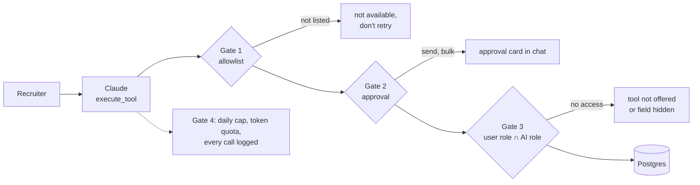

# AI tools and n8n plan

Which APIs the CRM has, which of them the AI chat can call as tools today, how to restrict that, and how to connect n8n the way HubSpot does. Planning only, no code changed. Checked 28 Oct 2026. Interactive version: https://claude.ai/artifact/2WTjdNGZzWUiV8DxPUHX6C

## Short version

- **We don't need to build a tool-calling chatbot.** The AI chat inherited from Twenty already calls tools: read, create, update and delete any record, send email, HTTP requests, workflows, even role and webhook admin. It needs the `AI` permission on the user's role and a model key in the Admin Panel.
- **The work is restriction.** The chat acts with the user's full role, the only code-level blocklist is two file-upload tools, and "ask before sending email" is the model's choice, not a server rule.
- **Plan:** four gates: permission flags, a FloLabs allowlist, server-enforced approval for sends and bulk edits, and an AI-only role.
- **n8n:** nothing official exists for Twenty. Copy HubSpot's design as our own community node: a credential, an action node with live dropdowns, and a trigger that registers its own webhook.

## 1. Every API the CRM exposes

| Surface | Route | Who can call it | For the chatbot |
|---|---|---|---|
| Records, GraphQL | `/graphql` | Session, API key, OAuth app | Same engine the AI's record tools use |
| Records, REST | `/rest/<objects>` | Session, API key, OAuth app | What n8n will call |
| Metadata | `/metadata`, `/rest/metadata/*` | Session, API key | Read only, for field pickers |
| MCP server | `POST /mcp` | Session, API key, OAuth app, agent | Exposes the AI tools to outside AI clients |
| AI chat and text | `/metadata` (`sendChatMessage`), `/rest/ai/generate-text` | Session with `AI` permission | The chatbot itself |
| Webhooks, outgoing | Settings or `/rest/webhooks` | Admin or API key | n8n trigger |
| Workflow webhooks, incoming | `/webhooks/workflows/:ws/:wf` | Public | n8n can start a CRM workflow |
| OpenAPI docs | `/open-api/core`, `/open-api/metadata` | Public | Reference |
| Files | `/file/...`, `/file-upload` | Signed per file | CVs, attachments |
| OAuth server | `/oauth/*`, `/.well-known/oauth-authorization-server` | Public | n8n OAuth2 credential |
| Public forms (FloLabs) | `/forms/:ws/:form` | Public, rate-limited | No |
| Team inbox (FloLabs) | `getInboxThreads`, `getInboxUnreadCount`, `markInbox...` | Session only | Not reachable today |
| Notifications, form stats (FloLabs) | `getNotificationsSeenState`, `getPublicFormStats` | Session only | Not reachable today |

Every record operation exists on GraphQL and REST: find many (filter, sort, cursor paging), find one, create (with upsert), create many, update, update many, soft delete, destroy, restore, merge, find duplicates, group by, and a cross-object `search`. Custom objects (Applications, Email Templates, Forms, Form submissions) get the same operations automatically.

API keys are limited to 100 calls a second and 100 a minute by default (`API_RATE_LIMITING_*`). User sessions, including the AI chat, have no speed limit; AI has token quotas.

## 2. What the AI chat can already call

| Tool group | Examples | Gated by | Verdict |
|---|---|---|---|
| Read records | `find_many_people`, `find_one_application`, `group_by_people` | Role: read | Allow |
| Create records | `create_one_task`, `create_one_note` | Role: update | Allow tasks, notes |
| Update one record | `update_one_person` (Stage) | Role: update | Approve |
| Bulk changes | `update_many_*`, `upsert_many_*`, `create_many_*` | Role: update | Approve |
| Delete | `delete_one_*`, `delete_many_*` (soft) | Role: soft delete | Block |
| Email | `draft_email`, `send_email`, `find_connected_accounts` | `SEND_EMAIL_TOOL` | Allow draft, approve send |
| Calendar | `create_calendar_event` | `CREATE_CALENDAR_EVENT_TOOL` | Later |
| Outbound HTTP | `http_request` | `HTTP_REQUEST_TOOL` | Block |
| Code | `code_interpreter` | `CODE_INTERPRETER_TOOL` | Block |
| Workflows | 22 tools: create, edit, activate, run | `WORKFLOWS` | Block in chat |
| Admin | roles, `upsert_object_permissions`, webhooks, agents, data model, dashboards | Settings flags | Block |
| Web search | model's built-in search | Model provider | Allow |

Key code:

- Tool registry: `packages/twenty-server/src/engine/core-modules/tool-provider/services/tool-registry.service.ts`
- Per-object record tools: `.../tool-provider/providers/database-tool.provider.ts`
- Action tools and their flags: `.../tool-provider/providers/action-tool.provider.ts`
- Chat role resolution (user's role only, empty agent map): `packages/twenty-server/src/engine/metadata-modules/ai/ai-chat/services/agent-chat-actor.service.ts`
- Chat blocklist (only two upload tools): `.../ai-chat/constants/ai-chat-excluded-tool-names.const.ts`
- `isToolAllowed` hook: `.../tool-provider/tools/execute-tool.tool.ts`
- MCP exclusions (`code_interpreter`, `http_request`): `packages/twenty-server/src/engine/api/mcp/constants/mcp-excluded-tool-names.const.ts`

## 3. Four gates between the model and the database

1. **Permission flags per role (no code).** Give Members `AI` and `SEND_EMAIL_TOOL`; leave HTTP request, code interpreter, workflows and data model off.
2. **A FloLabs allowlist (small).** Replace the two-item blocklist with an allowlist checked in `isToolAllowed`: read tools for people, applications, forms, form submissions, tasks, notes, email threads; create task and note; update person; draft and send email.
3. **Approval enforced by the server (small to medium).** `send_email`, `update_many_*`, `upsert_many_*` and Stage changes only run after the recruiter approves. Today the model may skip the approval card.
4. **An AI-only role (medium, biggest gain).** Run chat with an agent identity whose role is "AI Assistant", so the bot gets the overlap of the user's role and that role. Twenty already does this for background agents.
5. **Limits and audit (small).** Every tool call is stored in `agentMessagePart` with input and output. Add an "AI actions this week" view and a daily cap on write calls.

## 4. FloLabs tools that make the bot useful

| New tool | Lets you ask | Gate |
|---|---|---|
| `get_person_form_answers` | "What did Sara answer about her availability?" | Allow |
| `search_team_inbox` | "Who replied this week and hasn't heard back?" | Allow |
| `get_form_stats` | "Where do applicants drop off on the masterclass form?" | Allow |
| `move_stage` | "Move these 12 to INTERESTED" (checked against the stages) | Approve |
| `send_template_email` | "Send BEFORE MEETING to everyone booked Friday" | Approve |

Test only with `+crmtest` addresses.

## 5. n8n, the HubSpot way

| HubSpot piece | FloLabs CRM piece |
|---|---|
| Service Key or OAuth2 credential (URLs and scopes hidden) | API key + CRM URL, test call `currentWorkspace`; later OAuth2 + PKCE (scopes `api`, `profile`) |
| Action node: Contact, Company, Deal, Engagement, Ticket, live dropdowns | Person, Company, Application, Task, Note, Form, Form submission; dropdowns for fields, members, stages, positions, forms |
| Trigger: separate developer app, one URL per app, v1 signature only | Same API key; `POST /rest/webhooks` on activate, delete on deactivate; one webhook per workflow; HMAC-SHA256 of `timestamp:body`, reject stale |

Operations mirror HubSpot: Create or Update (by email), Get, Get Many, Search, Get Recently Created/Updated, Delete; Return All or Limit with cursor paging; Simplify; `usableAsTool` so n8n's AI Agent can drive the CRM.

How to build it:

- Own repo `n8n-nodes-flolabs-crm`, scaffolded with `npm create @n8n/node`, programmatic style (required for triggers).
- MIT and zero runtime dependencies, as n8n verification requires.
- Reuse the subscribe/unsubscribe pattern from `packages/twenty-zapier`, but not its code (AGPL).
- Existing community packages: about 18, none from Twenty; the self-registering trigger skips signatures, the signature-checking one needs manual webhooks, none has OAuth.

Phases:

1. **No code, this week:** HTTP Request node with an API key, a CRM webhook into an n8n Webhook node, and n8n's MCP Client Tool (bearer auth, streamable HTTP) pointed at the CRM's `/mcp`.
2. Credential and action node.
3. Trigger node.
4. OAuth2, field mapping for custom fields, optional n8n verification (from 1 May 2026, verified nodes must be published from GitHub Actions with npm provenance).

Decide first: which n8n instance, the first two or three flows, a narrow role for the n8n API key, who approves AI-sent emails.

## Not confirmed

docs.n8n.io and HubSpot's site were blocked from the sandbox; n8n facts come from n8n's source and docs repo, HubSpot-side facts from search results. Which model keys production has set. The API names of the Applications and Email Templates objects, which exist only in production data.
