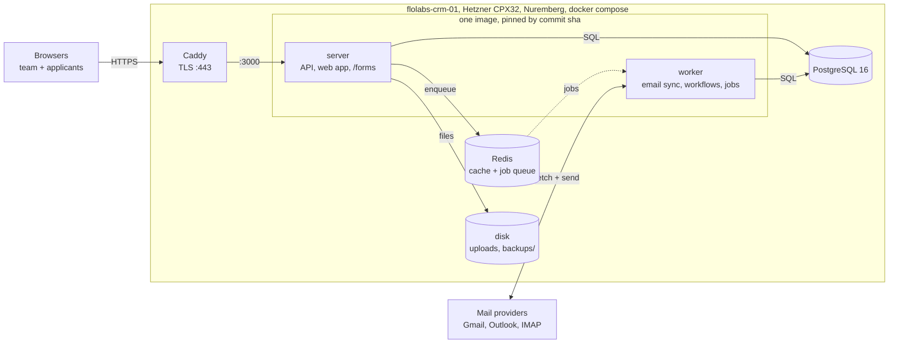
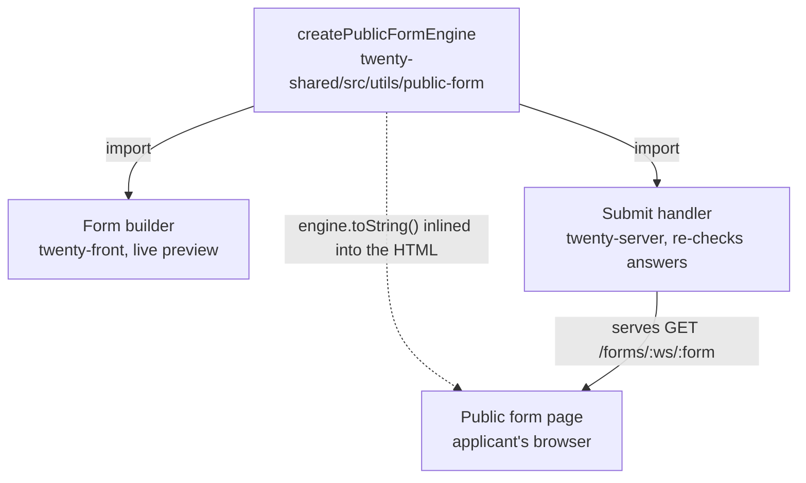
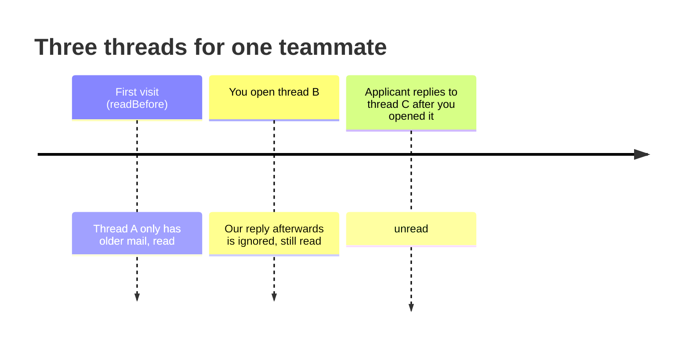
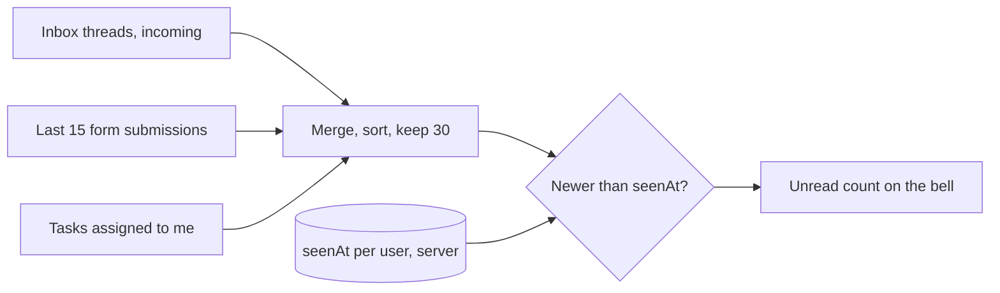
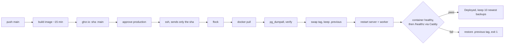

# FloLabs CRM architecture

How the CRM is put together, drawn as the paths data takes. Read from `FLOLABS.md` and checked against the code on 28 Oct 2026 (commit `7c6d9d9`). Interactive version with diagrams: https://claude.ai/artifact/1x6qRvx3nFbnVW2ddRmXMS

## 1. Everything runs on one server



- Only Caddy faces the internet. `server` and `worker` run the same image; slow work goes through the Redis queue.
- A deploy only changes the image tag in `docker-compose.override.yml`. Postgres, Redis, Caddy and the data stay put.
- Caddy, the override file and the server env file live only on the server, not in this repo.

## 2. One form engine, three places it runs



The public page is plain HTML built by the server, not the React app. The preview, the applicant's browser and the server apply the same rules, and the server evaluates everything again on submit.

`crmForm` and `formSubmission` are workspace custom objects created by `setup-forms.mjs`, not TypeORM tables. A form's questions and logic sit in one JSON field, `definition`.

## 3. What happens when an applicant presses Submit

Code: `packages/twenty-server/src/modules/public-form`.

| Step | What happens | If it fails |
|---|---|---|
| 1 | `POST /forms/:workspace/:form`, multipart, up to 5 files of 10 MB | |
| 2 | Hidden honeypot field filled? | Fake "thanks", nothing saved |
| 3 | Rate limit: 20 a minute per form + IP | Throttled |
| 4 | Form exists and status is `PUBLISHED`? | 404 "Form not available" |
| 5 | Engine re-checks answers and files | 400 with one error per field |
| 6 | Find person by lower-cased email (including deleted ones, restored), or create | |
| 7 | Write mapped answers to person fields | Value rejected: retry with email only, keep going |
| 8 | Insert Form submission (visible answers + calculated values) | |
| 9 | Timeline entry, attachments named `Question: file.pdf` | Timeline errors swallowed |
| 10 | 200, thank-you page or redirect | |
| after | After-submit actions, **not awaited**: set person values, create task, email the team, auto-reply. Errors logged, never shown. | |

## 4. When is a team-inbox thread unread?

No "read" column on emails. Each teammate has one JSON value in `core.keyValuePair`: `readBefore` (first visit), the time each thread was opened, and threads marked unread.

A thread is **read** when its newest *incoming* email is older than the time you opened it, or older than your first visit if you never opened it. Outgoing mail, including automated reminders, is never compared.



## 5. Notifications are a computed feed



Polled every 60 seconds, paused while the tab is hidden. No notification rows are written anywhere.

## 6. Shipping



The rollback swaps the image tag back; it does not restore the database. If a release ran a migration before failing, restore the pre-deploy dump by hand.

## 7. The bill

| Option | Per month |
|---|---|
| **Hetzner CPX32 (what we run)** | **$51** ($41.99 + $0.60 IPv4 + $8.40 backups) |
| AWS lean, one EC2 | $60 |
| AWS design, 1-year reserved | $110 |
| AWS design (EC2 + RDS + S3 + Vercel) | $136 |
| AWS fully managed | $220 |

## 8. Where the doc and the code part ways

- **Bug: new workspaces can't be created on a fresh database.** The Forms tab needs `FORM_SUBMISSIONS` in the Postgres enum `core."pageLayoutWidget_type_enum"`. Only the 2.48 upgrade command adds it, for existing workspaces. Seeding a new database failed with `invalid input value for enum ... "FORM_SUBMISSIONS"`. Production already has the value.
- **Bug: notification "seen" state never saves.** `packages/twenty-front/src/modules/notifications/hooks/useNotificationsSeenState.ts` sends its query and mutation to `/metadata`, but the resolver is on `/graphql`. The server answers 400 "Cannot query field getNotificationsSeenState". The bell falls back to "last 24 hours" and the cross-device read state doesn't work. Likely fix: pass the core Apollo client, like `useTeamInboxReadState.ts` does.
- **Doc vs code:** FLOLABS.md says a submit "creates a notification". It doesn't; the bell polls the latest form submissions.
- **Not in repo:** Caddy config, `docker-compose.override.yml`, the server env file, the SSH forced-command line, and the GitHub `production` environment's required reviewers.

## 9. Running it locally

Ran on 28 Oct 2026 in a cloud container with Twenty's demo data (1,200 people, 300 email threads).

```bash
bash packages/twenty-utils/setup-dev-env.sh
PGPASSWORD=postgres psql -h localhost -U postgres -d default -c "ALTER TYPE core.\"pageLayoutWidget_type_enum\" ADD VALUE IF NOT EXISTS 'FORM_SUBMISSIONS'"
npx nx command-no-deps twenty-server -- workspace:seed:dev
yarn start
TWENTY_URL=http://localhost:3000 TWENTY_TOKEN=<admin API key> node packages/twenty-utils/flolabs/setup-forms.mjs
```

Results:

- Valid submit of the Meeting Recordings form: person created with the email lower-cased, Form submission saved, shown on the person's Forms tab, bell went from 17 to 18.
- Submit with only a first name: 400 with one error per missing field, nothing saved.
- The repo asks for Node 24; Node 22 still installed and ran it.
