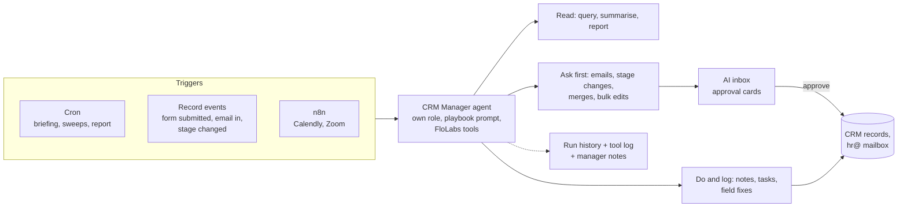

# CRM Manager: upgrading the chatbot into an agent that runs the pipeline

Research and plan, no code changed. 28 Oct 2026. Interactive version: https://claude.ai/artifact/KSwAzKpiLJvN7MiA1jxEX3

Builds on `ai-tools-and-n8n-plan.md` (APIs, tools, restrictions) and `n8n-and-workflows.md` (integrations).

## Short version

- **About 70% of the engine already exists in our fork.** Twenty 2.48.1 has background agents that run on a schedule or on record changes without anyone logged in, durable waits ("check again in 3 days"), run history, workflows with AI agent and classify steps, an AI inbox with approval cards, custom skills, custom tools as code, and dashboard tools. Most of it is switched off or not wired together.
- **What's missing is what makes it a manager:** background runs can't ask a human (hard-coded off), can't load skills, have no memory, send email from the workspace's oldest mailbox, and nothing reads incoming email.
- **The plan:** one "CRM Manager" agent with its own narrow role, eight recurring jobs mapped onto our pipeline stages, three risk tiers (do it, do it and log it, ask first), and an approval inbox. Autonomy goes up a step only when the numbers say it's safe.
- **One hard line:** the agent never rejects or advances an applicant on its own. Recruiting AI is regulated (GDPR Art. 22 now; EU AI Act high-risk obligations from 2 Dec 2027 per secondary sources). It prepares, explains and proposes; a person decides.
- **Upgrade first.** Upstream shipped 2.49 to 2.52 in 11 days. 2.49 adds async agent runs and workflows-as-code, and new official apps (call recorder 1.19) won't install below 2.49.

## 1. What the manager does, along our pipeline

Stages from the AI system prompt: New → reminders → Contacted → Before Meeting → Saturday meeting → Attended → Second Meeting → Agreement sent → Signed Paid / Signed Non paid; exits: No answer, Not Interested, Rejected by us.

| # | Job | Trigger | What it does | Tier |
|---|---|---|---|---|
| 1 | Morning briefing | Cron, 08:00 | New applicants, replies waiting, people stuck, today's meetings, forms completed. Posts to the AI inbox. | Read |
| 2 | Reply triage | New incoming email | Classifies intent (interested, question, reschedule, not interested, out of office, unsubscribe). Drafts the reply from the right template, proposes the stage change. | Ask first |
| 3 | Stage sweeper | Cron, hourly | Finds people in a stage too long (e.g. Contacted 3 days with no form). Drafts the reminder; after N reminders proposes "No answer". | Ask first |
| 4 | Form follow-through | Form submission created | Summarises answers, flags missing items and unsigned agreements, proposes the next stage and template (Websites & Presentations done → Before Meeting). | Ask first |
| 5 | Meeting ops | Calendly booking, Zoom transcript (via n8n) | Booking → Saturday meeting. After the call: attendance, summary note on the person, proposes Attended + Masterclass form. | Log / ask |
| 6 | Data hygiene | Cron, nightly | Duplicates by email and name, bad emails, phone and country formats, empty required fields. Proposes merges. | Log / ask |
| 7 | Agreements | Stage = Agreement sent | Waits, chases unsigned agreements, flags Signed without payment info. | Ask first |
| 8 | Weekly report | Cron, Monday | Funnel by stage and source, time in stage, form drop-off, reply times. Builds or updates a dashboard. | Read |

Plus the recruiter chat, upgraded with the FloLabs tools from `ai-tools-and-n8n-plan.md` (form answers, inbox search, form stats, move stage, send template).

## 2. How it fits together

Design rules, from Anthropic's agent guidance and what HubSpot, Salesforce and Ashby ship:

- **Deterministic first, model second.** Sweeps find candidates with filters (stage, dates, counts), then hand the model at most 20 to 50 records to judge. Don't run the model over 43,000 people.
- **Few, combined tools** named for the job: `move_stage`, `send_template_email`, `find_stuck_applicants`, `triage_reply`, `summarise_person`, `pipeline_report`, `propose_merge`. Each returns readable fields, not raw IDs, and errors that say what to do.
- **Autonomy is a dial.** Every job starts in "ask first". A job moves to "do and log" only after two weeks with 90%+ of its proposals approved unchanged.
- **The agent runs as its own user with least privilege**, like Agentforce's running user.
- **Everything is logged** with the agent's reason, and every write has an undo path (soft deletes only, previous values kept in the log).

## 3. What already exists, and the gaps

Checked in code; `S` = `packages/twenty-server/src`.

| Piece | Exists in 2.48.1 | Gap for the manager |
|---|---|---|
| Agents as records | `AgentEntity` with prompt, model, triggers; UI at `/agents` with Settings, Role, Triggers, Runs tabs | An agent with no role gets no tools: needs a "CRM Manager" role |
| Background runs | Cron and record-event triggers run without a user (`ai-agent-trigger`); cron checked every minute, max 100 runs per agent per hour, events batched up to 20 | Only two trigger types: no webhook trigger, no "email received" trigger beyond `message.created` (*unconfirmed* that email sync emits it) |
| Waiting | `wait_for_duration` (up to a year) and `wait_for_event` in every background run | Fine as is |
| Asking a human | AI inbox, approval cards, ask and form cards in the front; workflow AI agent step can ask a member | Trigger and API runs hard-code `canAskHumans: false` (`agent-trigger-runner.service.ts:97`, `agent-run.service.ts:258`). Workaround: run jobs as workflows with an AI agent step |
| Approval | `propose_tool_call` | The model decides whether to ask. Approval templates on tools are display only |
| Skills | `skill` entity; built-ins include crm-hygiene, meeting-prep, enrich, deal-review; custom skills via settings | `load_skills` only works in chat. Background runs need the playbook in the agent prompt |
| Memory | Workspace `aiAdditionalInstructions` (chat only), conversations attached to records | No long-term memory, no embeddings. Trigger runs start fresh. Use a "Manager notes" object or notes on people |
| Custom tools | Logic functions with tool settings become tools automatically | `LOGIC_FUNCTION_TYPE` defaults to disabled outside development; background agents can't see logic-function tools anyway. Build FloLabs tools in the fork instead |
| Workflows | Cron, record event, webhook, manual triggers; AI agent, classify, wait for event, send chat message with approval | Workflows are off in production until the team switches them on (FLOLABS.md) |
| Email | `send_email`, `draft_email`, campaigns (drafts) | With no user, mail goes from the workspace's oldest mailbox. Must pin hr@flolabsinnovations.com. Nothing classifies incoming mail |
| Calls | `callRecording` object with transcript and summary; official apps for Teams, Fathom, Fireflies, Granola | No Zoom app. Get Zoom transcripts in through n8n |
| Reporting | `group_by_*` tools, dashboard tools | Fine as is |
| Evals | Classify engine for scoring | No agent eval harness: build a set of 30 real cases |
| Flags | `IS_AI_CHAT_INBOX_ENABLED` gates the AI inbox, agent tools, Triggers and Runs tabs | Off by default for new workspaces; production value *unconfirmed* |

## 4. What the market does (condensed)

| Capability | Who ships it | For us |
|---|---|---|
| Chat over CRM data that writes back | Ask Attio, Pipedrive, Zoho Zia | Have it |
| Research and analytics agent | Dynamics Sales Research Agent, HubSpot Data Agent, Greenhouse chart agent | High: funnel, drop-off, time in stage |
| Reply handling and intent | Agentforce SDR, Dynamics Sales Qualification Agent | High: job 2 |
| Outreach drafting, review then autonomous | HubSpot Prospecting Agent | High: templates |
| Stall and follow-up alerts | folk, Pipedrive | High: job 3 |
| Scheduled agents that pause for a human | Ashby Scheduled Agents, LangChain ambient agents | High: the whole model |
| Interview notes into the record | Ashby, Greenhouse, Lever notetakers | Medium-high: job 5 |
| Application review with per-criterion reasons, no auto-reject | Ashby, Gem, Greenhouse, Workable | Valuable, regulated (section 5) |
| Rediscovery of past applicants | Gem | Medium: 43k past records |
| Scheduling | Paradox, Ashby, LinkedIn Hiring Assistant | High, via Calendly + n8n |

Recurring guardrails: autonomy dial, AI orders but humans decide, explanations beside every output, per-feature off switches, agent as its own least-privilege user, credit or spend caps, audit trail and traces, sandbox testing, deterministic steps for high-stakes flows, an inbox for anything needing a person.

Security lesson: in July 2025 the Paradox hiring chatbot for McDonald's exposed up to 64 million applications through an admin password of "123456" and an ID you could change in the URL. Keep the manager off public endpoints and give every key a narrow role.

## 5. Compliance for AI in recruiting

Not legal advice; confirm with counsel. Which rules apply depends on where applicants live.

- **GDPR Art. 22 (EU/UK applicants):** no decisions with significant effect made solely by automated means; people can ask for human review and contest. The CJEU (SCHUFA, C-634/21) held that a score that decisively drives the outcome counts as the decision even if a person signs off. So a person must really decide, not rubber-stamp.
- **EU AI Act:** recruitment AI is high-risk (Annex III). After the Digital Omnibus, those obligations apply from **2 Dec 2027** (secondary sources). Already in force: no emotion recognition at work, AI literacy for staff. Deployers must keep logs at least 6 months and have trained humans overseeing. Because we build it ourselves, we may count as a provider, with heavier duties.
- **UK ICO:** run a DPIA early, collect only what's needed, never infer gender or ethnicity from names.
- **US, if we hire there:** NYC Local Law 144 (bias audit, notice), California (keep records 4 years; automated-decision rules from 1 Jan 2027), Illinois (notice, no discriminatory use), Colorado (from 1 Jan 2027).

What this means for the build:

1. The agent never sets Rejected by us, Not Interested, or a Signed stage by itself.
2. Any applicant ranking shows reasons per criterion, strips names and photos first, and is optional.
3. Keep the tool log for at least 4 years.
4. Tell applicants AI assists the team, in the application form's privacy text.
5. Do a DPIA before job 4 or any ranking goes live.

## 6. Upgrade or build

Upstream released 2.49.0 (19 Oct), 2.50 (21 Oct), 2.51 (23 Oct) and 2.52 (27 Oct). Release notes couldn't be read from the sandbox; these come from the published SDK types and npm metadata.

| Version | What helps the manager |
|---|---|
| 2.49 | Async agent runs (`waitForCompletion: false`, status RUNNING); `defineWorkflow()` so jobs ship as versioned code with AI agent, classify and wait steps; new SDK and official apps require ≥2.49 |
| 2.50 | Workflow AI steps can set an output format (*unconfirmed*); Node security fixes |
| 2.51 | Agent chat channels in the data model (undocumented): a shared place where the agent posts and the team steers it |
| Apps | Call recorder 1.19 with AI summaries (needs ≥2.49), Teams transcripts, Slack assistant |

Recommendation: upgrade to the latest minor, one version at a time with a backup, before building the manager (FLOLABS.md section 8 has the process). Build the manager's FloLabs tools and gap fixes in our fork, like the forms feature, since logic functions are disabled in production by default.

## 7. Build plan

| Phase | What | Code | Exit criteria |
|---|---|---|---|
| 0. Prepare | Decide on workflows switch-on; upgrade to 2.52; turn on `IS_AI_CHAT_INBOX_ENABLED`; Anthropic key; "CRM Manager" role (read most objects, write notes and tasks only); sandbox workspace with copied data; DPIA | Upgrade only | Sandbox runs, role reviewed |
| 1. Read-only manager | Jobs 1 and 8; FloLabs read tools (form answers, inbox search, form stats, stuck applicants, pipeline report) | Small | Team uses the briefing daily for 2 weeks |
| 2. Assisted | Jobs 2, 3, 4, 7 as proposals; gap fixes: let trigger runs post to the AI inbox, playbook in prompt, pin the hr@ mailbox, server-enforced approval for sends, stage moves and bulk edits | Medium | 90%+ proposals approved unchanged per job |
| 3. Autopilot, tier 1 | Notes, tasks and field fixes without asking; job 6; "Manager notes" memory; eval set of 30 real cases run 5 times each | Medium | Evals pass 5 of 5; undo tested |
| 4. Integrations | Job 5 through n8n: Calendly → stage, Zoom transcript → call recording → summary | Medium (n8n node) | Bookings and transcripts land without manual work |

Throughout: only `+crmtest` addresses until phase 2 is approved; one job at a time; a per-job off switch.

## 8. Decisions needed

1. Upgrade to 2.52 before starting? (Recommended.)
2. Turn workflows on now that HubSpot is on the Free plan?
3. Which jobs first? (Recommended: briefing, then reply triage.)
4. Who approves AI-drafted emails, and from which mailbox?
5. Where applicants live (EU, UK, US) for the compliance checklist, and who owns the DPIA.

## Sources

Code: this repo at `7c6d9d9`. Market and compliance: vendor docs and articles found by web search (HubSpot, Salesforce, Microsoft, Attio, Ashby, Gem, Greenhouse, Workable, LinkedIn, Paradox; EU AI Act service desk; gdpr-text.com; CJEU C-634/21; ICO; NYC OSC audit 2 Dec 2025). Agent design: anthropic.com/research/building-effective-agents, anthropic.com/engineering/writing-tools-for-agents, anthropic.com/engineering/effective-context-engineering-for-ai-agents, anthropic.com/news/context-management, anthropic.com/engineering/demystifying-evals-for-ai-agents. Upstream versions: npm registry (`twenty-sdk`, `@twentyhq/*`) and Docker Hub tags. Several vendor sites, docs.twenty.com and twenty.com/releases were blocked from the sandbox; claims marked *unconfirmed* need a check.
