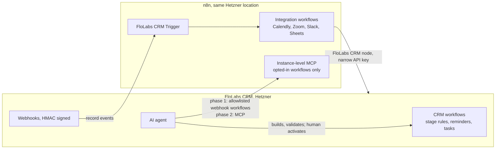

# n8n and workflows: how CRMs integrate it, and what we should do

How HubSpot and other CRMs connect to n8n in both directions, how n8n workflows get created, and the architecture we recommend for FloLabs CRM. Research only, no code changed. 28 Oct 2026. Interactive version: https://claude.ai/artifact/BxJAZ13TFhKJzw4rmaeDte

The HubSpot n8n node itself (credentials, resources, trigger) is covered in `ai-tools-and-n8n-plan.md`.

**Source caveat:** docs.n8n.io, n8n.io and HubSpot's site were not reachable from the research sandbox. n8n facts come from search excerpts of those pages, the n8n forum and blogs; Twenty facts were checked in this repo. Items marked *unconfirmed* need a check before we rely on them.

## Short version

- Every serious CRM integration with n8n has **two directions**: the CRM pushes events out (webhooks, usually signed), and n8n writes back through a node with a credential and live dropdowns.
- **Our CRM already has a full workflow engine** with an AI agent step, a classify step, wait-for-event, HTTP requests and 22 tools that let the AI build workflows. Most recruiting automations belong there, not in n8n.
- **n8n is for anything that crosses into other apps:** Calendly, Zoom, Slack, job boards, Google Sheets.
- **For the AI agent to use n8n safely:** call a fixed allowlist of n8n webhook workflows as tools first; later use n8n's instance-level MCP, which only runs workflows you opted in. Avoid giving the agent an n8n API key: outside Enterprise, keys can't be scoped.
- **Licensing:** running n8n for our own recruiting is internal use and allowed. Never expose the n8n editor to outsiders without an n8n Embed agreement.

## 1. Both directions, CRM by CRM

| CRM | n8n node and credential | Events into n8n | CRM pushing out on its own |
|---|---|---|---|
| HubSpot | Built-in; Service Key or OAuth2 | Trigger registers developer-app webhook subscriptions on activate | "Send a webhook" workflow action (HTTPS only, Data Hub Pro or Enterprise); custom code actions in Node.js |
| Salesforce | Built-in; OAuth2 or JWT, new setups via External Client Apps | Salesforce Trigger (account, contact, lead, case, opportunity events); polling *unconfirmed* | Flow HTTP Callout (REST/JSON); Outbound Messages are SOAP without HMAC |
| Pipedrive | Built-in; API token or OAuth2 (trigger needs `webhooks:full`) | Webhook registered on activate: object + added/updated/merged/deleted | Plain webhooks on all plans; automation "webhook request" action needs Advanced plan |
| Zoho CRM | Built-in; OAuth2, region-specific token URL | No trigger node (*unconfirmed*); use Schedule or Webhook node | Workflow-rule webhook, up to 6 per rule |
| Copper | Built-in; API key + email, Professional or Business | Trigger node exists, mechanism *unconfirmed* | |
| Attio | No official node; community `n8n-nodes-attio` | Via Attio workflows | "Send HTTP request" workflow block; SDK workflow blocks |
| Close | No official node; community node with polling triggers | Polling | Webhook subscription API |
| **Twenty / FloLabs CRM** | No official node; community packages or HTTP Request node with an API key | Settings webhooks, HMAC-SHA256 signed (`X-Twenty-Webhook-Signature`) | Workflow HTTP Request action; workflow Webhook trigger brings data in |

The pattern to copy from the best ones (HubSpot, Pipedrive): **the trigger registers its own webhook when the n8n workflow is switched on, and removes it when switched off.** Twenty's webhook API supports exactly that.

## 2. How n8n workflows get created

| Way | How it works | Notes |
|---|---|---|
| By hand | n8n canvas | The default; the "proper UI" |
| Templates | Workflow JSON imported from URL, file or paste; self-hosted can point at its own library with `N8N_TEMPLATES_HOST` | Exported JSON can leak credential names and IDs, and auth headers from cURL imports. Example HubSpot template: https://n8n.io/workflows/4839 |
| AI Workflow Builder | Describe the workflow, n8n drafts it | Credit-metered on Cloud (50 Starter, 150 Pro); self-hosted availability *unconfirmed* |
| Public REST API | `/api/v1`, header `X-N8N-API-KEY`; create, activate, deactivate workflows | Only Enterprise keys can be scoped; other keys see everything. Exact routes from a third-party guide, *check against the official reference* |
| Instance-level MCP | Owner enables it; each workflow opted in separately; `/mcp-server/http` with Bearer token | `search_workflows`, `get_workflow_details`, `execute_workflow`; building workflows over MCP needs v2.13+; Community Edition availability *unconfirmed*; can be removed with `N8N_DISABLED_MODULES=mcp` |
| Agent inside n8n | MCP Server Trigger exposes chosen workflows as tools; Call n8n Workflow Tool runs sub-workflows | Lets n8n's own AI Agent use our CRM tools |

## 3. Embedding n8n inside the CRM

- **Sustainable Use License:** internal business use is allowed, including running n8n behind the scenes. Letting external users build workflows, or white-labelling n8n, is not. Building an n8n node for our product is allowed.
- **n8n Embed:** iframe with token-exchange SSO and "credential overwrites" (one global OAuth app, users never see secrets). Pricing not public; a forum user reports about $50k a year (*unconfirmed*).
- **Alternatives:** Zapier embedded editor (free for partners, app must be in Zapier's directory), Make White Label (sales), Pipedream Connect (Workday announced its acquisition on 19 Nov 2025), Workato Embedded and Paragon (proprietary), Activepieces (MIT core, embed from about $36k a year by its own blog).

For an internal recruiting team, embedding is not needed. Link to our n8n from the CRM sidebar instead.

## 4. Automations inside the CRM vs in n8n

Twenty's own engine, checked in this repo:

- **Triggers:** database event (record created, updated, deleted), manual, cron, webhook. `packages/twenty-server/src/modules/workflow/workflow-trigger/types/workflow-trigger.type.ts`
- **Actions (22):** create, update, upsert, delete, find and pick records; filter; if/else; iterator; form; delay; wait for event; HTTP request; code; logic function; send email; draft email; send chat message; create calendar event; **AI agent**; **classify**. `packages/twenty-shared/src/workflow/types/WorkflowActionType.ts`
- **The AI can already build workflows:** `create_complete_workflow`, `validate_workflow`, `activate_workflow_version`, `list_workflow_runs` and 19 more in `packages/twenty-server/src/modules/workflow/workflow-tools/tools/`.

| Put it in the CRM's workflows when | Put it in n8n when |
|---|---|
| It reads or writes CRM records only (stage changes, tasks, reminders, follow-ups) | It touches other apps (Calendly, Zoom, Slack, Sheets, job boards) |
| It should respect CRM roles and show in the record's timeline | It needs third-party OAuth credentials or a big connector catalogue |
| An email goes from our connected mailbox | It needs long retry chains or many AI steps across systems |

HubSpot, Salesforce, Pipedrive and Attio all work this way: in-CRM builders for record logic, a webhook action to push out, and an iPaaS (n8n, Zapier, Make) for everything else. Several gate the outbound webhook action behind paid plans; we don't have that limit.

## 5. Recommended architecture for FloLabs

1. **Recruiting rules stay in the CRM's own workflows.** Stage changes, form follow-ups, reminders, tasks. The AI agent can draft these with its existing tools; a human activates them.
2. **Integrations go in n8n.** Calendly booking, so a Saturday meeting moves the stage; Zoom recordings and transcripts onto the person; Slack alerts; reporting exports.
3. **Wiring:** CRM webhooks into the FloLabs CRM Trigger (verify the signature); n8n writes back with the FloLabs CRM node using a dedicated API key with a narrow role. Keep n8n on Hetzner's private network and expose only webhook paths.
4. **AI agent and n8n, safely:** start with a fixed allowlist of n8n webhook workflows exposed as agent tools. Move to n8n's instance-level MCP once confirmed on our edition: it can only run workflows we opted in. Keep agent-made n8n workflows unpublished until reviewed. Don't hand the agent an n8n API key.
5. **Team UI:** n8n Community Edition has no shared projects, credential sharing, SSO or Git; only the owner and a workflow's creator can open it. With several people building, that is the first limit we'll hit; check n8n's paid self-hosted plans if it bites.

## 6. Licensing

- **n8n:** our own recruiting use is internal use, allowed by the Sustainable Use License. Don't expose the editor to interns or other companies.
- **Our fork:** `LICENSE` includes a "Twenty Application Exception": apps that only talk to Twenty through its APIs, webhooks or SDKs (an n8n node, n8n workflows) are not bound by AGPL. Our changes to the fork itself stay AGPL.
- **Enterprise files:** server files marked `/* @license Enterprise */` (billing, SSO, row-level permissions, record sharing) need a Twenty Enterprise subscription. The workflow engine and webhooks are not among them.

## Unconfirmed

Salesforce Trigger polling; that Zoho has no trigger; the Copper Trigger mechanism; exact n8n REST routes; whether the AI Workflow Builder and instance-level MCP run on self-hosted Community Edition; n8n Embed and Activepieces pricing.
